# Build Lantern Reach in Mod Studio

This tour recreates the original `templates/showcase` mod through Studio controls. The screenshots show Studio itself, without game artwork. Start with **New mod**, rather than copying the finished template.

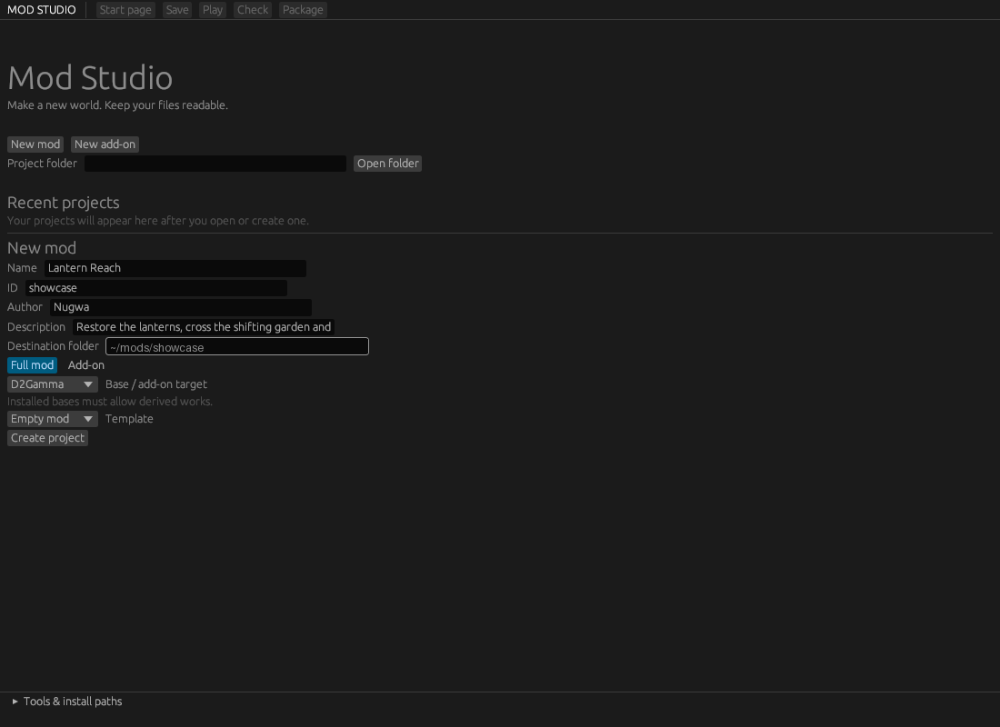

Enter Lantern Reach, ID `showcase`, author Nugwa, and version `1.0.0`. Keep it a full mod. Turn the market and ladder off, leave character copying off, and approve `showcase-notes` as its optional add-on. Under **Tools & install paths**, select the game executable, your converted native install and your installed mods folder.

Create the definitions before linking their uses:

1. **Named stats:** add `resonance`, save ID 40000.
2. **Difficulties:** name the four entries Dawn, Gale, Dusk and Eclipse.
3. **Acts & waypoints:** add Lantern Reach, levels 137 through 139, town 137. Waypoint IDs 0, 1 and 2 lead to those levels.

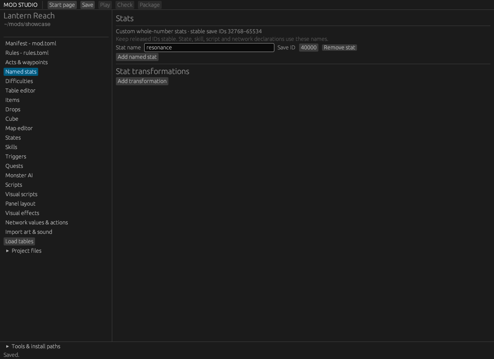
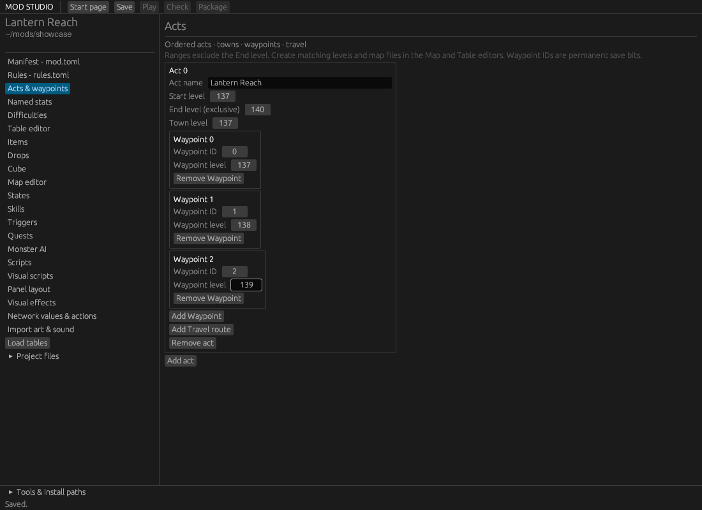

Import the showcase's original artist library through **Import art & sound → Native asset library**, and import its PNG icon. This is an art import, not a copy of the template's gameplay definitions. Studio does not need, or package, the player's base-game art.

In **Map editor**, start from the imported harbor DS1 and lantern DT1. Clone the level twice. Set entries, world offsets, reciprocal exits and waypoint objects. Make the garden a **Maze**, stamp its beacon clearing, and give Lens Court its own source and boss spawn. **Show seeded layout** previews what the random rules produce; change the seed to inspect another realization.

In **States**, create Prism shell (185) and Lantern Ward (186). The shell gives 100 to each of the six resistance stats; Ward lasts two seconds, stacks three times and gives ten armor per stack. In **Rules**, choose declared crowd control. In **Monster AI**, create the Glass Warden graph at index 148, a four-second pulse cooldown, guard and fractured states, telegraphed wind-ups and attacks. Below half life, enter the fractured phase with a two-second immune window. Declare state 185 as the immunity state.

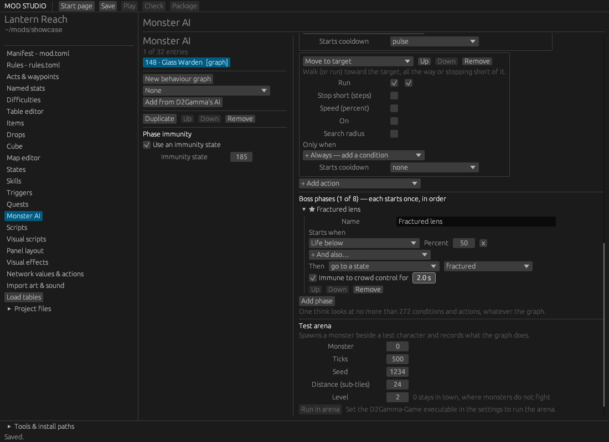

Use **Visual scripts** to add, name and position the charge and kill-event nodes. Connect their typed pins and control edges using the canvas or the source/target pickers. Charge reads resonance, adds one, caps it at twenty and writes it back. The kill event checks the unit type before showing its message. Test-fire **kill** against the fake unit, step through the trace, and open **View generated Luau** to inspect the compiled result.

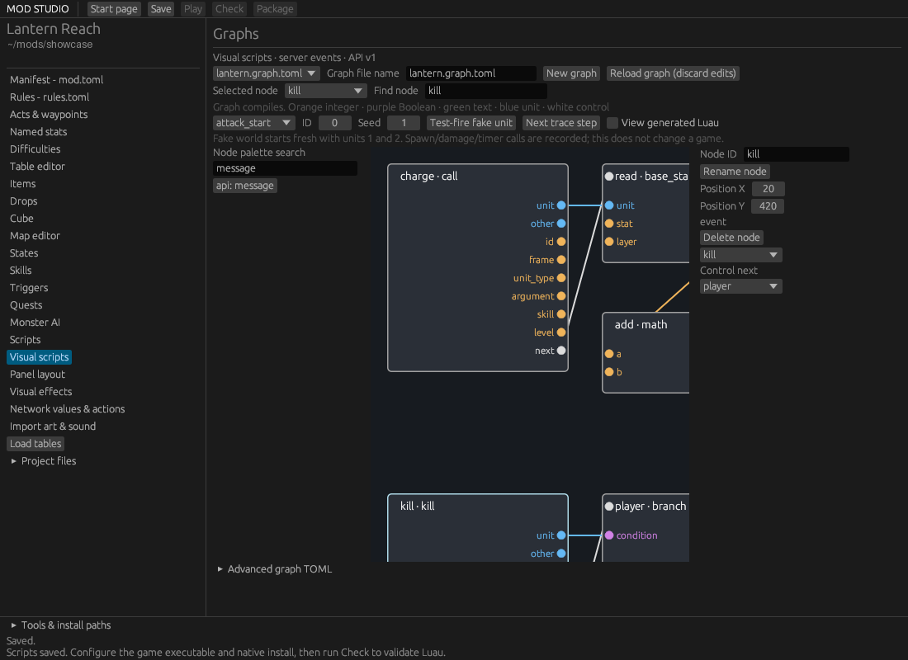
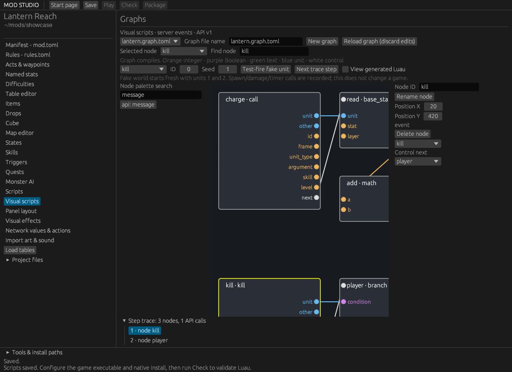
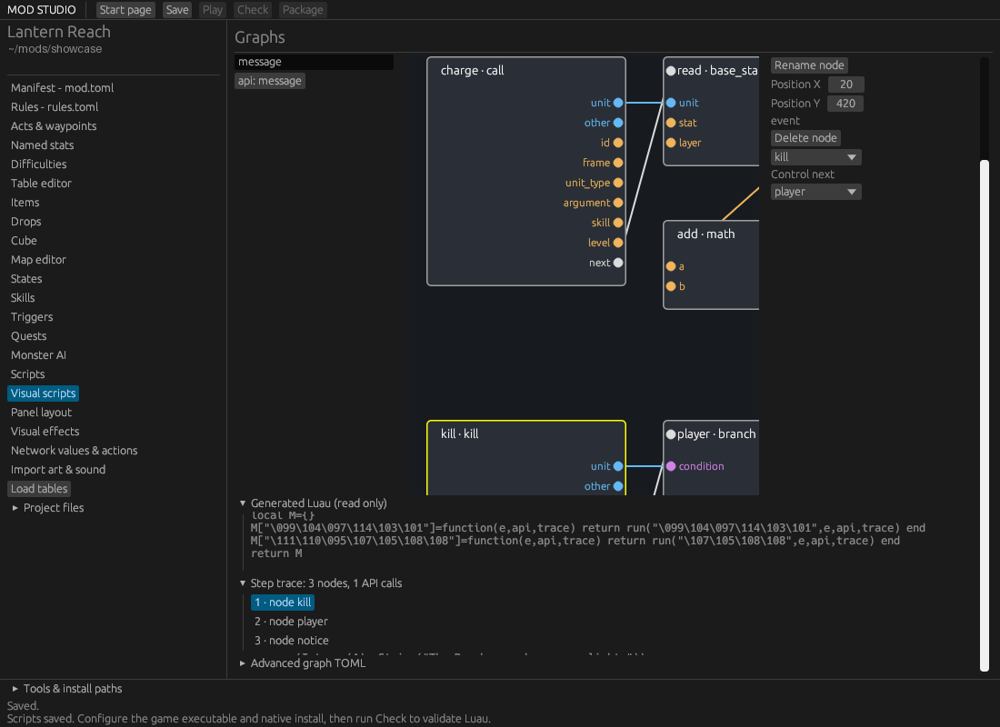

In **Scripts**, create `ward.luau` with the showcase's Ward, expiry and button-validation handlers. In **Skills**, make Lantern Pulse (357): call `lantern.graph.toml::charge`, call `ward.luau::ward`, then apply its magic area hit and declared interrupt. A state-end trigger calls `ward.luau::expired` for Ward.

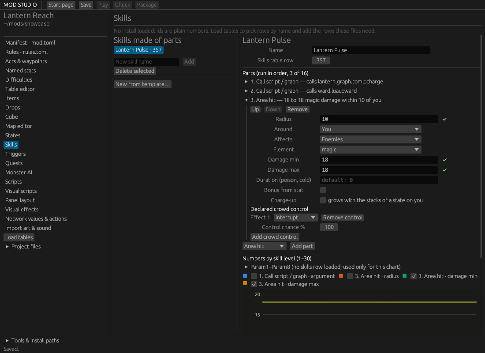

In **Quests**, add Gather the light and Quiet the lens. The first enters the garden and gives two glimmers. The second collects those glimmers and kills monster 734, then gives a Beacon Seal and completion message. **Write quest log panel** creates the bound progress display; use **Panel layout** to set its title, labels and positions.

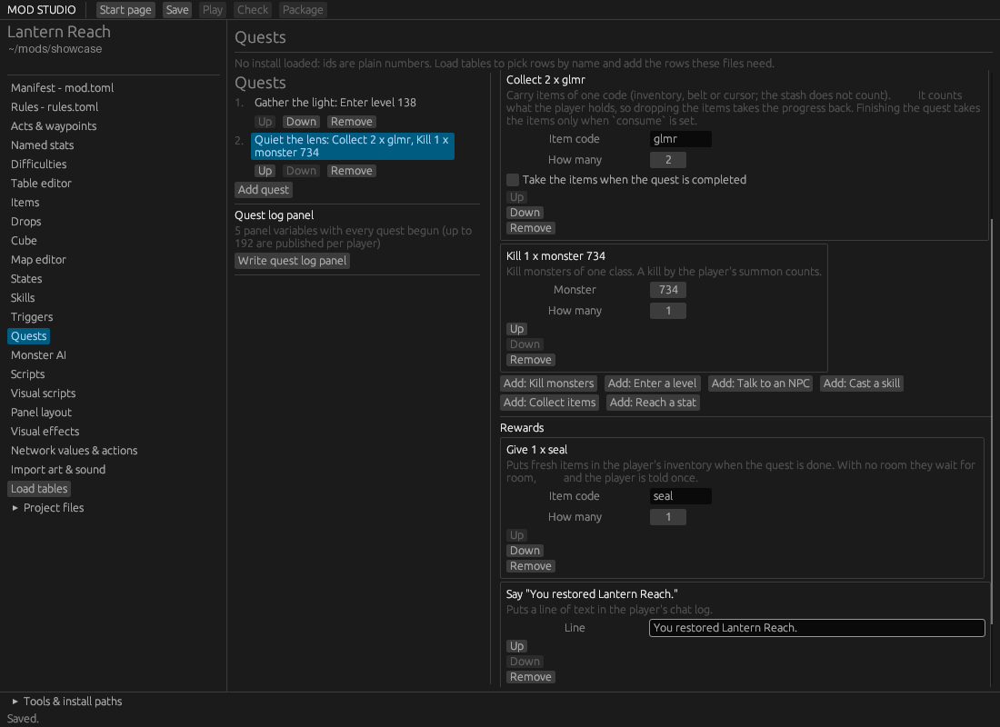

In **Network values & actions**, declare synced value `resonance` from `stat.resonance`. Declare server action `charge`, adding one between zero and twenty with a 25-tick cooldown, and select `ward.luau::can_charge` as its validator. In **Panel layout**, bind the HUD text to `sync.resonance` and give its button action `net.charge`. Add the Ward indicator and the lens effect recipe in **Visual effects**.

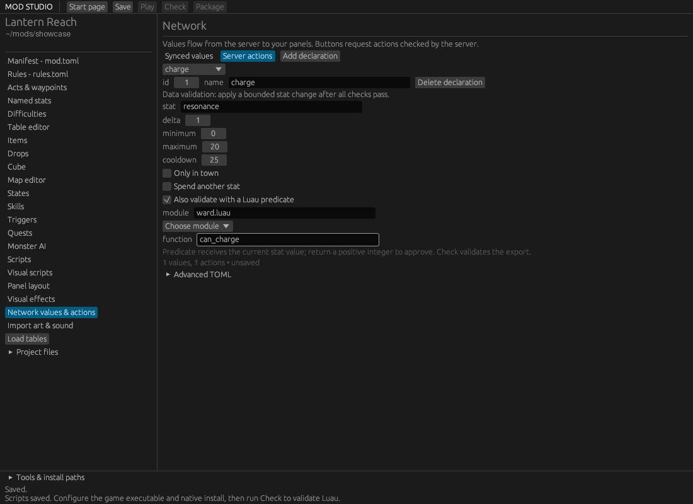
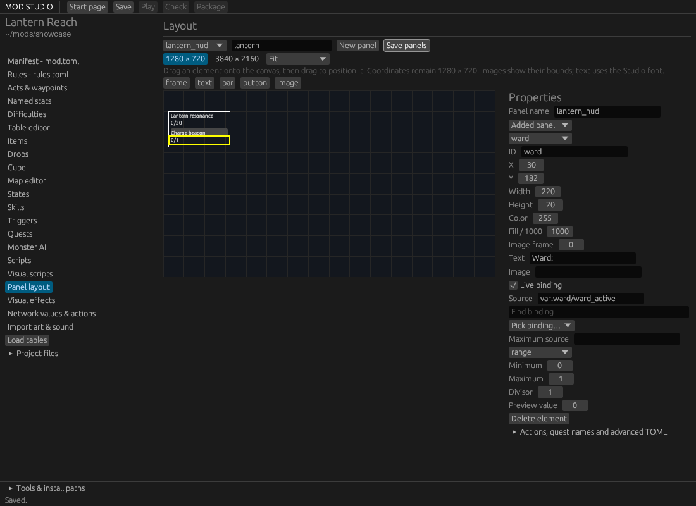

Use **Table editor** to add the levels, boss, item, state, skill-description and skill rows described by the showcase. **Find table**, **Selected row** and **Edit column** reach a specific cell without scrolling across a large sheet. **Strings and UI labels** supplies their display names. Studio saves a guarded patch, rather than copying the installed tables.

Save the project, return to the start page, and choose **New add-on**. Use ID `showcase-notes`, target Lantern Reach and **Screen only**. Make its route-note panel in the layout editor. The full mod's approval and the player's enable choice remain separate.

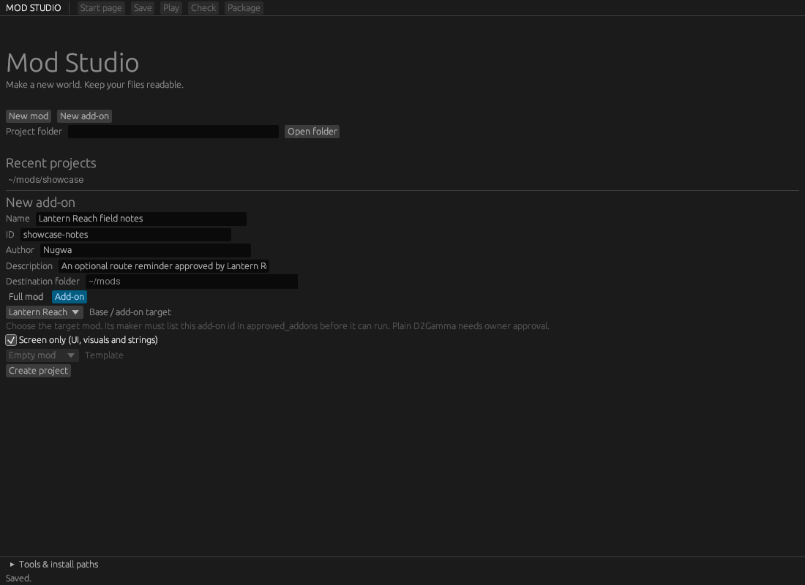

Run **Check** and follow any problems back to their editor. **Package** checks a saved snapshot before signing it. **Play** saves and starts the real game with this project; **Stop game** ends that play session. For the in-game route, see the [showcase walkthrough](showcase-walkthrough.md).

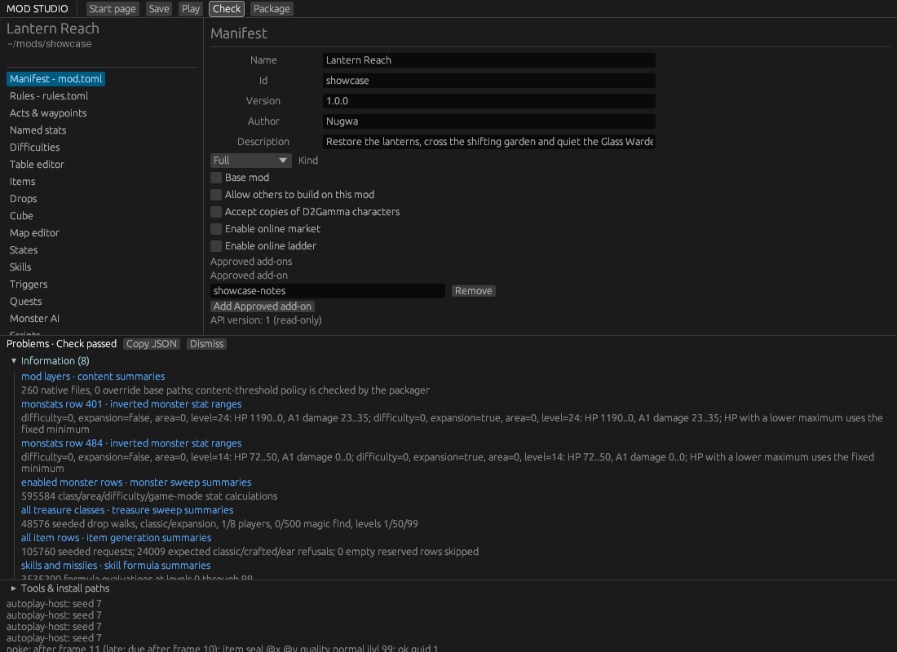
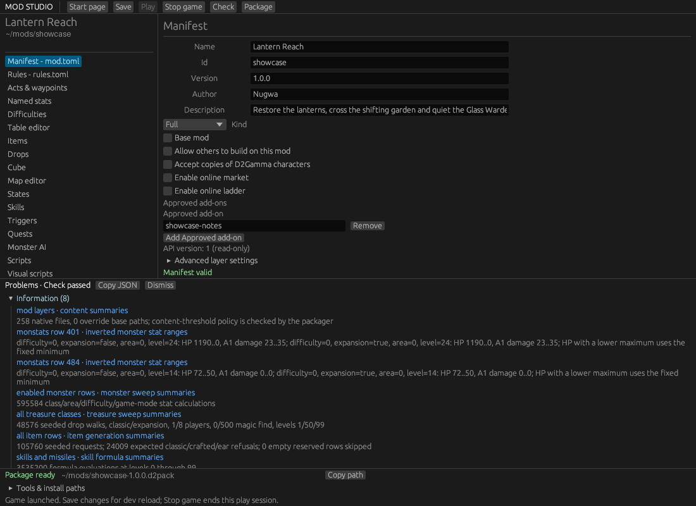

The automated tour sends ordinary egui pointer, keyboard and wheel events. Its saved output is compared with the template through the same readers used by the engine, including every effective table cell and original asset. TOML formatting, comments and Studio's patch ownership do not change gameplay. The tour's [input recordings and reproduction commands](../../tools/studio-tour/README.md) are checked in. Its [findings and validation](studio-dogfood-findings.md) describe the fixes and the separate game-window judgments.
